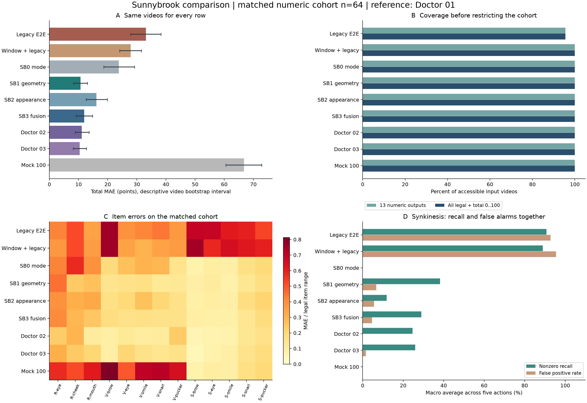

# Sunnybrook 统一评价矩阵与方法比较

在全部方法共同完成的 64 段视频上，旧版完整流程总分 MAE 为 33.11 分，平均偏差为 31.42 分；SB1 的 MAE 为 10.66 分。完整结果还需结合下面的输出覆盖率、分项误差与联动误报率判读。

评价日期：2026-11-07。doctor01 的 13 个分项为 ground truth，总分统一由分项公式计算。纳入历史 68 段评估视频，当前可访问 67 段。每段视频作为一次独立评估；重复患者的不同访视可能跨折，因此属于访视层面开发验证。

旧版完整流程、旧规则的取帧诊断、SB0 至 SB3、两位年轻医生及接口固定满分对照采用同一指标实现。所有旧版源文件保持原样，不修正除零、取帧或评分规则。

## 统一评价矩阵

| 评价维度 | 主要指标 | 同时检查 | 判读规则 |
| --- | --- | --- | --- |
| 输入与输出覆盖 | 数值输出率和合法输出率 | 缺失视频、失败类别、分项越界、总分越界 | 与误差同时报告，失败不补成正常分 |
| 总分误差 | MAE 及描述性重采样区间 | RMSE、平均偏差、绝对一致性 ICC A,1、Bland Altman 界限 | 统一在相同视频上比较，不用相关系数代替一致性 |
| 三大维度 | 静态、自主运动、联动各自归一化 MAE | 维度加权分的 MAE | 三维度等权，避免五个自主运动项掩盖其他维度 |
| 十三个分项 | 分项 MAE 与二次加权 Kappa | 完全一致率、相差不超过一级、现有真值等级的平衡召回率与宏 F1、混淆矩阵 | 同时列等级样本数；未出现等级不假定已学会 |
| 非零联动 | 各动作召回率和误报率 | 精确率、F1、阳性例数，五动作宏平均 | 不用大量零分形成的高准确率说明检出能力 |
| 配对比较 | 相同视频的绝对误差差值 | SB1 对其他方法、算法对两位医生 | 每次配对使用同一行索引，区间跨零不宣称优越 |
| 误差分层 | 按专家总分区间的 MAE | 每层样本数；后续可接入人工质量标签 | 稀疏层仅描述，不设未验证的临床阈值 |
| 运行成本 | 旧版工作进程单视频中位耗时与 P95 | 模型初始化与取帧在内，两个并发任务 | 研究特征缓存与新跑旧版的耗时不直接排名 |

合法分项范围依次为静态 0–1、0–2、0–1，自主运动各 1–5，联动各 0–3。总分为 4 × 自主运动和 − 5 × 静态和 − 联动和。完整数值预测即使越界也保留并计入原始误差；另行统计合法输出率。分项混淆矩阵保留非法等级，避免丢掉旧版输出的自主运动零分。

## 固定实验协议

- 使用原固定外层五折、内层三折和 seed 20261012，SB0 至 SB3 从现有特征重新训练，逐项核对原有折外预测。标准化、PCA 与参数选择只使用各自训练折。
- 学习算法保留历史 68 段训练流程；当前共同输入队列在运行旧版之前按源文件可访问性冻结。缺失视频的历史特征只用于复现原实验，不伪造其旧版预测。
- 三位医生 CSV 指纹及可访问视频 SHA-256 均与历史记录核对；doctor02、doctor03 只作对照。缓存、折号、代码指纹和逐视频结果保留在本地 artifacts。
- 旧版完整流程保留整段视频几何极值选帧、原始颜色输入和静息帧索引。参考窗口诊断用既有提取器选出的静息中点及动作峰值时间，经 OpenCV 定位取帧，再执行同一个旧版 IMAGE 评分器；它不代表人工动作真值。旧代码使用当前研究依赖环境运行，不声称复原当年未锁定的部署环境；environment.json 记录实际版本，并阻止跨环境混用同一输出目录的缓存。
- 不使用全量训练后的导出模型评价训练视频，不调整阈值，不裁剪分项或总分，不根据测试结果重新分折。固定100分只作为占位对照。
- 配对视频 bootstrap 5000 次。区间为描述性结果，不包含重复患者依赖及重新训练的不确定性，不作为正式显著性检验。5、10、15 分误差带仅为工程描述，不是临床等效阈值。

## 可访问视频的完成率

| 方法 | 输入数 | 数值输出 | 全部合法 | 非法分项行 | 总分越界行 | 原始 MAE及其样本数 |
| --- | ---: | ---: | ---: | ---: | ---: | --- |
| 旧版完整流程 | 67 | 64 | 64 | 0 | 0 | 33.11，n=64 |
| 参考窗口加旧版规则 | 67 | 67 | 67 | 0 | 0 | 27.55，n=67 |
| SB0 | 67 | 67 | 67 | 0 | 0 | 23.93，n=67 |
| SB1 | 67 | 67 | 67 | 0 | 0 | 10.45，n=67 |
| SB2 | 67 | 67 | 67 | 0 | 0 | 16.04，n=67 |
| SB3 | 67 | 67 | 67 | 0 | 0 | 11.69，n=67 |
| doctor02 | 67 | 67 | 67 | 0 | 0 | 10.81，n=67 |
| doctor03 | 67 | 67 | 67 | 0 | 0 | 10.39，n=67 |
| 接口固定100分 | 67 | 67 | 67 | 0 | 0 | 66.61，n=67 |

本表最后一列可能采用不同子集，用于了解各方法实际产出，不据此进行跨方法排名。全体方法共同有数值输出的视频结果如下。

## 全部方法共同视频比较

共同队列 n=64。下表所有行使用完全相同的视频；原始越界值保留。

| 方法 | 总分 MAE | 描述性95%区间 | RMSE | 偏差 | ICC A,1 | 三维等权归一化MAE | 联动召回率 | 联动误报率 |
| --- | ---: | --- | ---: | ---: | ---: | ---: | ---: | ---: |
| 旧版完整流程 | 33.11 | [27.91, 38.33] | 39.35 | 31.42 | 0.161 | 0.509 | 90.7% | 92.7% |
| 参考窗口加旧版规则 | 27.88 | [24.08, 31.56] | 31.89 | 24.97 | 0.319 | 0.494 | 88.9% | 95.4% |
| SB0 | 23.84 | [18.64, 29.19] | 32.33 | -19.12 | -0.017 | 0.276 | 0.0% | 0.0% |
| SB1 | 10.66 | [8.30, 13.05] | 14.48 | -2.78 | 0.810 | 0.193 | 38.2% | 6.7% |
| SB2 | 16.11 | [12.61, 19.92] | 21.93 | -6.58 | 0.440 | 0.225 | 11.9% | 5.6% |
| SB3 | 11.91 | [9.20, 14.80] | 16.43 | -3.69 | 0.740 | 0.198 | 29.0% | 4.6% |
| doctor02 | 11.06 | [8.83, 13.59] | 14.67 | 8.56 | 0.857 | 0.148 | 24.6% | 0.0% |
| doctor03 | 10.41 | [8.17, 12.72] | 13.97 | -5.81 | 0.832 | 0.170 | 26.0% | 1.6% |
| 接口固定100分 | 66.78 | [60.53, 72.81] | 71.40 | 66.78 | 0.000 | 0.455 | 0.0% | 0.0% |

联动召回率和误报率为五个动作宏平均；逐动作的阳性数、混淆矩阵、总分误差带、分层结果和全部13个分项位于本地 results.json。

## 三大维度误差

同一共同队列上的归一化分项 MAE。每列以各分项合法跨度归一化后在该维度取平均，越小越好。

| 方法 | 静态 | 自主运动 | 联动 |
| --- | ---: | ---: | ---: |
| 旧版完整流程 | 0.427 | 0.476 | 0.623 |
| 参考窗口加旧版规则 | 0.417 | 0.423 | 0.641 |
| SB0 | 0.464 | 0.238 | 0.125 |
| SB1 | 0.320 | 0.144 | 0.116 |
| SB2 | 0.344 | 0.198 | 0.132 |
| SB3 | 0.315 | 0.163 | 0.116 |
| doctor02 | 0.214 | 0.133 | 0.098 |
| doctor03 | 0.253 | 0.150 | 0.108 |
| 接口固定100分 | 0.568 | 0.673 | 0.125 |

## 十三个分项误差

同一共同队列上的原始等级 MAE。各分项等级跨度不同，跨分项比较时应结合上表及汇总图。

| 分项 | 旧完整 | 窗口旧规则 | SB0 | SB1 | SB2 | SB3 | 医生02 | 医生03 | 固定100 |
| --- | ---: | ---: | ---: | ---: | ---: | ---: | ---: | ---: | ---: |
| 静态眼 | 0.422 | 0.375 | 0.422 | 0.453 | 0.391 | 0.406 | 0.234 | 0.312 | 0.578 |
| 静态鼻唇沟 | 1.031 | 1.031 | 1.156 | 0.484 | 0.625 | 0.578 | 0.594 | 0.484 | 1.031 |
| 静态嘴 | 0.344 | 0.359 | 0.391 | 0.266 | 0.328 | 0.250 | 0.109 | 0.203 | 0.609 |
| 抬眉运动 | 3.031 | 3.031 | 0.750 | 0.578 | 0.672 | 0.703 | 0.359 | 0.375 | 3.250 |
| 闭眼运动 | 1.562 | 1.375 | 1.062 | 0.641 | 0.797 | 0.641 | 0.484 | 0.828 | 1.969 |
| 微笑运动 | 1.672 | 1.203 | 1.203 | 0.672 | 1.047 | 0.656 | 0.406 | 0.625 | 2.797 |
| 呲牙运动 | 1.766 | 1.391 | 1.156 | 0.484 | 0.812 | 0.625 | 0.453 | 0.547 | 2.844 |
| 嘟嘴运动 | 1.484 | 1.469 | 0.594 | 0.500 | 0.641 | 0.625 | 0.953 | 0.625 | 2.594 |
| 抬眉联动 | 2.078 | 2.250 | 0.219 | 0.266 | 0.250 | 0.281 | 0.172 | 0.141 | 0.219 |
| 闭眼联动 | 2.062 | 1.750 | 0.297 | 0.328 | 0.297 | 0.250 | 0.203 | 0.219 | 0.297 |
| 微笑联动 | 1.828 | 1.953 | 0.266 | 0.234 | 0.266 | 0.250 | 0.219 | 0.266 | 0.266 |
| 呲牙联动 | 1.797 | 1.859 | 0.500 | 0.391 | 0.531 | 0.406 | 0.391 | 0.453 | 0.500 |
| 嘟嘴联动 | 1.578 | 1.797 | 0.594 | 0.516 | 0.641 | 0.547 | 0.484 | 0.547 | 0.594 |

## SB1 的配对比较

| 对照方法 | 共同视频数 | SB1 MAE | 对照MAE | SB1减对照误差 | 描述性95%区间 |
| --- | ---: | ---: | ---: | ---: | --- |
| 旧版完整流程 | 64 | 10.66 | 33.11 | -22.45 | [-29.09, -15.75] |
| 参考窗口加旧版规则 | 67 | 10.45 | 27.55 | -17.10 | [-22.13, -11.76] |
| SB0 | 67 | 10.45 | 23.93 | -13.48 | [-17.94, -9.13] |
| SB2 | 67 | 10.45 | 16.04 | -5.60 | [-8.88, -2.34] |
| SB3 | 67 | 10.45 | 11.69 | -1.24 | [-3.31, 0.87] |
| doctor02 | 67 | 10.45 | 10.81 | -0.36 | [-3.49, 2.78] |
| doctor03 | 67 | 10.45 | 10.39 | 0.06 | [-2.93, 3.12] |
| 接口固定100分 | 67 | 10.45 | 66.61 | -56.16 | [-63.58, -48.52] |

差值小于零表示 SB1 误差较小。不同配对行的队列可能不同，不能用这些差值做传递排名。

## 旧版失败与设计限制

- 旧版完整流程：数值完成 64/67，合法完成 64/67；失败类别 {'IndexError': 2, 'ZeroDivisionError': 1}。
- 参考窗口加旧版规则：数值完成 67/67，合法完成 67/67；失败类别 {}。
- 静态鼻唇沟在旧版代码中始终为0；自主运动用左右比例映射，不能区分两侧运动均很小和两侧运动充分；联动由非目标几何比例经验公式产生。
- 全局极值取帧没有动作分段约束；原版未检查每帧是否检测到人脸，多个比例未保护零分母。参考窗口诊断有助于区分选帧问题和评分规则问题，但没有隔离 OpenCV 定位、JPEG 与图像检测误差。
- SB1 至 SB3 的动作窗口仍是六等分假设；尚未接入标注工具的人工动作边界。SB1 在这批数据的较低误差不代表已经验证对新患者或新医院的效果。

## 本机旧版运行耗时

| 方法 | 已运行视频数 | 中位秒数 | P95秒数 |
| --- | ---: | ---: | ---: |
| 旧版完整流程 | 67 | 6.83 | 14.19 |
| 参考窗口加旧版规则 | 67 | 0.62 | 0.88 |

耗时包括旧版模型初始化、选帧和评分，按两个并发任务记录；运行失败任务也计入。参考窗口诊断使用预先计算的峰值时间，表内不包含这些时间的提取成本，因此不是可直接部署的完整视频延迟。SB0 至 SB3 本次复用历史特征，未分别测量端到端耗时，不据此进行性能排名。

## 结果解释与后续顺序

旧版完整流程在共同视频上的总分误差高于训练折众数基线，并存在明显高估。参考窗口取帧能够降低一部分误差，但旧规则的分项和联动表现仍差。高联动召回率同时伴随大量误报，不能解释为较好的联动识别。

SB1 是这批开发数据中总分 MAE 最低的学习算法，适合作为后续优化基线；SB1 与 SB3 的配对区间跨零，尚不能确认两者差异稳定。SB1 与两位年轻医生的总分误差接近，但配对区间也均跨零，且三维度等权归一化分项误差仍高于两位医生，不能据总分相近宣称已达到或超过医生整体水平。

后续先将人工动作区间接入特征提取，检查静态鼻唇沟与非目标区域联动特征，再在同一评价协议下增加新版本。最终模型冻结后，用新患者视频做独立测试；现有视频访视队列用于开发比较。

## 历史完整队列复现

SB0 至 SB3 的重新训练预测与原始折外文件逐项一致。下表保留历史68段结果，不能将它与不同队列的旧版单行直接排名。

| 方法 | 视频数 | 总分 MAE | RMSE | 偏差 | ICC A,1 |
| --- | ---: | ---: | ---: | ---: | ---: |
| SB0 | 68 | 23.66 | 32.09 | -19.22 | -0.014 |
| SB1 | 68 | 10.38 | 14.22 | -2.76 | 0.812 |
| SB2 | 68 | 15.88 | 21.63 | -6.91 | 0.445 |
| SB3 | 68 | 11.53 | 16.08 | -3.65 | 0.745 |
| doctor02 | 68 | 10.71 | 14.29 | 7.94 | 0.859 |
| doctor03 | 68 | 10.32 | 13.94 | -6.00 | 0.828 |
| 接口固定100分 | 68 | 66.75 | 71.26 | 66.75 | 0.000 |

## 汇总图



## 复现入口与结果文件

使用仓库 src/fphelper 中的研究代码及 tools/benchmark 统一评估入口。评估依赖见 pyproject.toml；旧版另需 OpenCV 和 MediaPipe。命令示例：

```sh
PYTHONPATH=src python tools/benchmark/run.py \
  --source /absolute/path/to/artifacts/first-validation \
  --data-root /absolute/path/to/fp \
  --output artifacts/unified-evaluation-20261107
```

输出的 protocol.json 固定输入与评价规则，results.json 保存全部矩阵指标，predictions.csv 和 predictions.npz 保存匿名逐视频结果，status.json 保存失败与耗时，training-folds.json 保存嵌套验证记录，legacy-cache 按视频和代码指纹缓存结果。临时 JPEG 由父进程拥有的临时目录清理，包括工作进程失败或超时。

本次使用已有研究环境运行，未把虚拟环境或原始患者视频复制到桌面仓库。完整结果位于仓库 artifacts/unified-evaluation-20261107。

## 方法依据

参数选择与外层性能评估分开的原则见 [scikit-learn 嵌套验证](https://scikit-learn.org/stable/auto_examples/model_selection/plot_nested_cross_validation_iris.html)。分项二次加权 Kappa 的实现定义见 [scikit-learn 指标文档](https://scikit-learn.org/stable/modules/generated/sklearn.metrics.cohen_kappa_score.html)。
