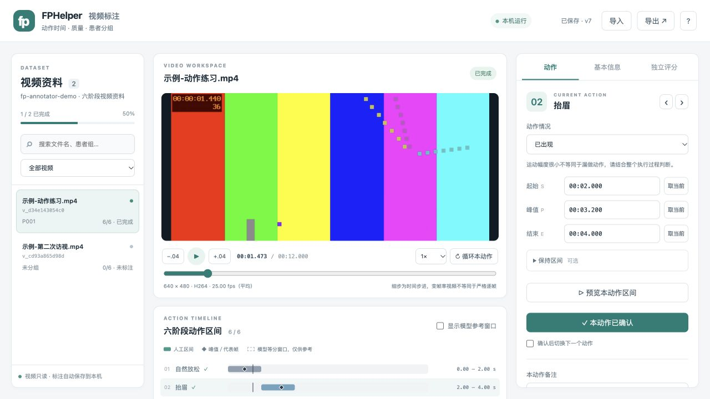

# FPHelper 本地视频标注工具

用于面部动作视频的时间区间、质量和患者分组标注，也可记录独立 Sunnybrook 评分。网页和服务都在本机运行，视频从原目录只读播放，标注自动存入本地 SQLite，保留历史版本。



## 启动

在 Finder 中双击本目录的 `启动标注工具.command`，或在 FPHelper 根目录运行：

```sh
python3 tools/annotator/server.py --open
```

启动后打开 `http://127.0.0.1:8765`。默认查找本机 OneDrive 的 fp 目录；也支持指定目录和端口：

```sh
python3 tools/annotator/server.py --data-root "/absolute/path/to/fp" --port 8765 --open
```

数据目录可以是包含 `videos` 子目录的 fp，也可以直接是视频目录。支持 MP4、MOV、M4V 和 WebM，实际播放能力取决于浏览器解码支持；当前 FP 视频使用的 H.264 MP4 已通过浏览器验收。

服务使用 Python 标准库，无需安装前端依赖；本机需要 `ffprobe`，可使用已有 FFmpeg 安装。程序也会查找 Homebrew 的常见安装位置。终端按 Ctrl+C 停止服务。端口被占用时，请指定其他端口。

## 标注流程

1. 选择视频，点击“载入当前视频”。视频不会在选中时自动加载画面。
2. 在“基本信息”填写标注人代号；患者组使用 P001 等匿名代号，未知可以留空。同一患者的不同访视填写相同患者组，各视频仍保留独立评估。
3. 依次判断自然放松、抬眉、轻闭眼、露齿微笑、呲牙和嘟嘴是否出现。设置起始、峰值或代表帧、结束时间，需要时再填保持区间。
4. 观看区间后点击“确认本动作”。缺少动作或无法判断时填写原因并确认，时间保持空值。运动幅度小不自动视为漏做。
5. 记录质量标记、成片镜像、摄像头和患者患侧。原清单的患侧只作参考，需要另行核实。
6. 六阶段均处理后，点击“完成本条”。这里表示标注工作完成；缺少或不确定动作仍保留原状态，不表示视频已完整执行评分协议。也可以将整条标记为“待复核”。

修改后约半秒自动保存，顶部显示保存状态。视频切换前会等待保存；发生连接或版本冲突时保留浏览器草稿，提供下载与重新载入入口。历史恢复创建新版本，保留原版本。

时间以秒存储，支持直接输入 `12.500` 或 `00:12.500`。零秒是有效起点，未标注使用 null。细步按钮移动 0.04 秒，变帧率视频不等同于严格逐帧定位。

## 快捷键

| 按键 | 操作 |
| --- | --- |
| 空格 | 播放或暂停 |
| 1–6 | 选择动作 |
| S、P、E | 起始、峰值、结束取当前播放时间 |
| [、] | 保持区间起止取当前时间 |
| 左右方向键 | 后退或前进 0.04 秒 |
| Shift 加左右方向键 | 后退或前进 1 秒 |
| R | 预览当前动作区间 |
| V | 确认当前动作 |
| Command 或 Ctrl 加 S | 立即保存 |
| Command 或 Ctrl 加 Z | 撤销本页修改 |

输入框内保留文字编辑快捷键。播放速度支持 0.25 至 2 倍，可循环预览已设置的动作区间。

## 独立评分

“独立评分”是可选功能，开启后先填写评分者代号。13 个分项只接受其合法整数范围，未评分保持空白。全部评分及动作确认完整时显示公式研究总分；不完整时显示空总分，超出 0–100 的组合提示复核并保留原始数值。

独立评分与原医生 CSV 分开保存，不覆盖或自动复制 doctor01、doctor02、doctor03 的记录。后续训练应结合动作存在、人工确认状态和评分者来源选择有效标签。

## 保存与导出

默认保存位置为 `FPHelper/artifacts/annotations/<dataset_id>/annotations.sqlite3`，位于已被 Git 忽略的目录。每次保存记录版本号、时间和标注人；同一记录在两个页面发生修改时，通过版本检查拒绝覆盖。

可以用 `--annotations-dir /absolute/path` 指定另一保存目录，工具仍按数据目录标识分开保存。原视频指纹变化时，旧标注保留并拒绝复用；先确认文件来源，必要时使用新的标注目录。

导出菜单提供：

| 类型 | 用途 |
| --- | --- |
| 全部标注 JSON | `manual-actions-v1` 格式，含文件指纹、实际动作区间、确认状态、质量、分组及独立评分，可在本工具重新导入 |
| 完整患者分组 CSV | `video_id,patient_group_id` 两列，可用于现有分组工具；全部视频都填写患者组后才能导出 |
| 患者分组模板 CSV | 保留已填代号，未知留空，供后续补齐再导入 |
| 模型动作核验证据 ZIP | 每个视频一份 JSON，供现有 `assess --action-evidence` 使用；只包含另行人工核验的模型等分窗口 |
| 当前页面草稿 JSON | 保存失败或冲突时，用于保留本页内容 |

JSON 导入会验证视频标识、指纹和字段，保留服务器已有标注，跳过重复记录。患者分组 CSV 导入会更新非空患者组，其他标注保留，更新前会提示；导入失败时回滚整批。

SQLite 使用 WAL 事务。日常备份优先导出 JSON；需要直接复制数据库时，先停止服务，再复制完整标注目录。视频、标注、评分和文件指纹均按本地患者数据衍生物管理。

## 与现有算法衔接

默认读取现有 `artifacts/first-validation/manifest.json` 中匹配文件的 video_id，保证分组导出可与算法清单关联；也支持 `--manifest /path/to/manifest.json`。没有匹配清单时，以视频文件名的 stem 生成稳定标识。

目录与训练清单中的视频集合不一致时，页面显示缺少或新增的视频数量和标识，仍可标注可访问视频。完整训练分组表需要先补齐视频或显式选择更新后的清单；分组模板和标注 JSON 可正常导出。工具不创建缺失视频的虚构标注。

实际动作区间属于 `manual-actions-v1`。当前历史训练器仍使用 `relative-six-phases-ffmpeg-pts-v1` 等分窗口，后续提取器需显式接入人工区间才能利用新的边界。

“显示模型参考窗口”只显示等分参考。确认实际区间不会自动确认模型窗口；需要逐段查看模型窗口，再勾选对应核验项并填写方法，才会生成供现有 assess 使用的核验证据。证据绑定视频 SHA-256 和模型窗口协议，不代替临床验证。

## 验证

```sh
python3 -m unittest discover -s tools/annotator/tests -v
node --test tools/annotator/tests/core.test.js
```

测试使用临时模拟文件和回环端口，不读取患者视频。浏览器验收使用合成示例视频，检查载入、时间编辑、确认、自动保存、服务重启恢复及导出。
